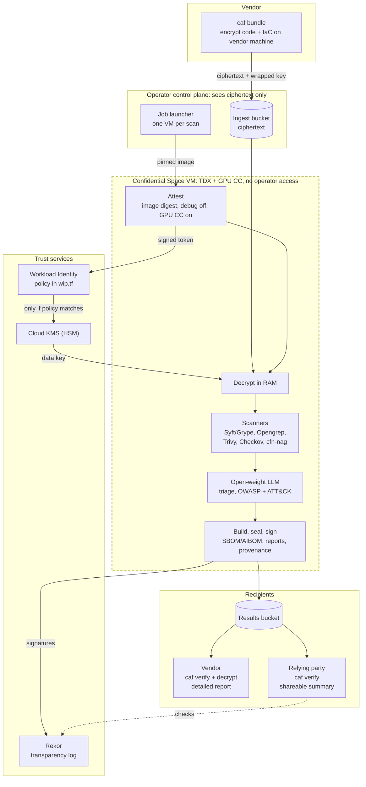

# Confidential Assurance Framework (CAF)

**Confidential, verifiable third-party product assurance.**

CAF assesses a vendor's product inside an attested hardware trusted execution environment (TEE) and issues signed
assurance artifacts that any relying organization can verify and reuse. The vendor's proprietary assets only ever
exist in plaintext inside the TEE. The operator running the service cannot read them, and nobody has to take the
operator's word for that.

The assessment profile, implemented in this repository, scans **source code and infrastructure-as-code**
(Terraform, CloudFormation, Python, Java and other common code files) for CVEs and code weakness findings that are then mapped to OWASP and MITRE ATT&CK scenarios.

- **The workload is open source and reproducibly built.** Anyone can rebuild the container from this repository
  and get the same image digest.
- **Keys are released only to that digest.** Decryption and signing keys are bound by IAM conditions to
  hardware attestation claims (e.g. image digest, debug disabled, GPU confidential-computing mode on). A unverified or modified
  image cannot the SaaS vendors data encryption keys.
- **Every output is signed and logged.** Artifacts are signed with an attestation-gated key and recorded in a
  public transparency log, so relying parties can verify them without contacting the operator.

> Status: **pre-alpha reference implementation.** The architecture is specified in
> [`docs/architecture.html`](docs/architecture.html). Code under `workload/`, `cli/` and `infra/` is scaffolding
> with clearly marked `TODO`s. Do not process real vendor code until the
> [production readiness checklist](#production-readiness) is complete.

## What a scan produces

| Artifact | Audience | Protection |
|---|---|---|
| SBOM + AIBOM of the scanning service (CycloneDX 1.6) | Anyone | Signed, cleartext |
| Detailed vulnerability report (CVEs, SAST/IaC findings, OWASP + ATT&CK mappings, remediation) | Vendor only | HPKE-encrypted to the vendor's key inside the TEE |
| Shareable assurance report (counts by category, severity, technique; nothing prescriptive) | Vendor's prospective customers | Signed, cleartext, template-rendered from aggregates only |
| in-toto provenance statement binding inputs, workload, model and outputs | Anyone | Signed, Rekor-logged |

## How it works



More diagrams, including the step-by-step scan sequence and the reproducible-build trust loop, are in
[`docs/diagrams.md`](docs/diagrams.md).

## Repository layout

| Path | Contents |
|---|---|
| `workload/` | The measured TEE container: pipeline, scanner orchestration, report builder, signer |
| `cli/` | Vendor tool: encrypt and upload bundles; verify and decrypt results |
| `infra/terraform/` | GCP deployment: KMS, Workload Identity pool with attestation conditions, buckets, VPC-SC |
| `rules/` | Project-maintained Opengrep and IaC rules (Apache-2.0) |
| `schemas/` | JSON Schemas for findings and the shareable report |
| `templates/` | Shareable-report template (renders from aggregates only) |
| `eval/` | Model evaluation harness specification |
| `docs/` | Architecture, threat model, verification guide |

## Verify a scan result

```bash
pip install ./cli
caf verify --results results/ --signing-pubkey artifact-sign.pem \
                  --expected-digest sha256:<published workload digest>
caf decrypt --results results/ --key vendor-hpke.key --job-id <job id>
```

See [`docs/verification.md`](docs/verification.md) for the full relying-party procedure, including reproducing the
workload image digest from source.

## Production readiness

- [ ] Reproducible build verified independently by two parties
- [ ] Third-party audit of `workload/` and the attestation policy, published
- [ ] Model selected via `eval/` and pinned by hash in the AIBOM
- [ ] Rule packs license-reviewed (see [`THIRD_PARTY_LICENSES.md`](THIRD_PARTY_LICENSES.md))
- [ ] Minimum TCB / firmware versions encoded in key-release conditions
- [ ] Incident response and key-rotation runbooks exercised

## Contributing and security

Contributions are welcome under the [Developer Certificate of Origin](CONTRIBUTING.md#sign-off).
Report vulnerabilities privately as described in [`SECURITY.md`](SECURITY.md). Never put vulnerability details
in a public issue.

## License

Apache License 2.0. See [`LICENSE`](LICENSE) and [`NOTICE`](NOTICE). Third-party components and models keep their
own licenses; see [`THIRD_PARTY_LICENSES.md`](THIRD_PARTY_LICENSES.md).
