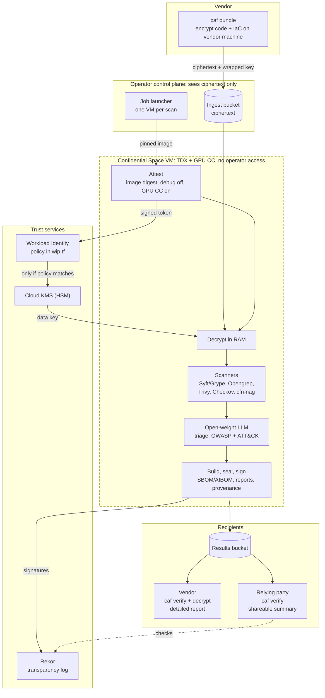
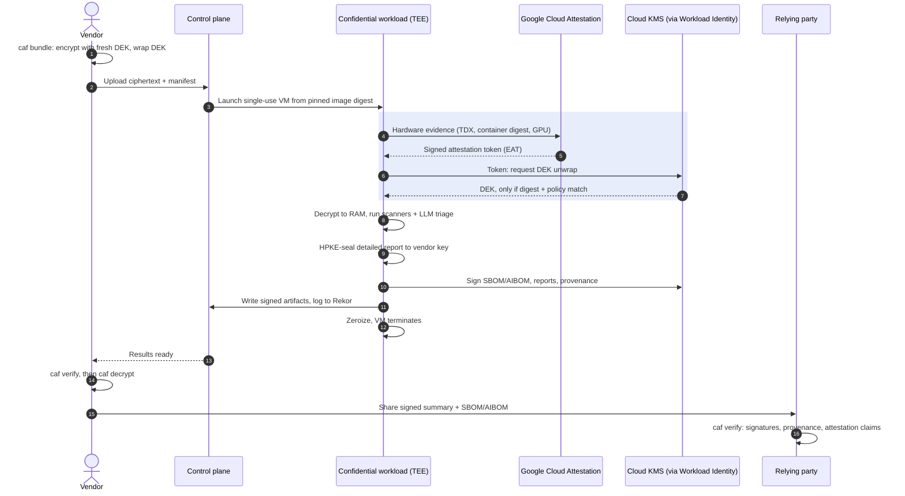
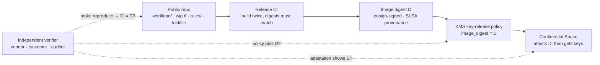

# Diagrams

Mermaid sources render directly on GitHub. The full specification, with detailed figures, is
[`architecture.html`](architecture.html).

## 1. System architecture

Who holds what. Vendor plaintext exists only inside the dashed Confidential Space box. The control plane moves
ciphertext and never holds decrypt or signing rights. KMS releases the data key only when the attestation token
matches the policy in `infra/terraform/wip.tf`.

## 2. One scan, end to end

The blue section is attestation-gated key release: the only way a decryption key can reach the workload.

## 3. Why open source matters: the reproducible-build trust loop

Anyone can rebuild the workload from source and confirm it is the only image that can obtain keys.

